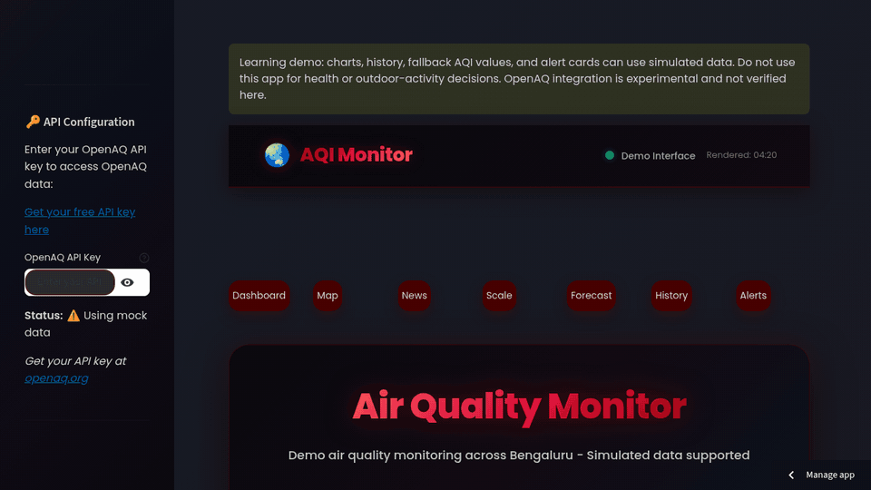

# Bengaluru AQI Dashboard

A Streamlit learning project for exploring air-quality visualizations, station maps, and saved regression models. It includes generated sample values. It is not a verified source of current air quality or a health-warning service.



## What is implemented

- Station/location selection and a Folium map for Bengaluru.
- Pollutant charts and AQI category displays.
- Saved scikit-learn ensemble models and an optional LSTM artifact.
- An experimental OpenAQ integration with a user-entered API key.
- Simulated history and example alert cards. Alert preferences do not send notifications.

Without a key, the interface runs with demonstration/fallback values. Entering a key does not prove a successful connection. The OpenAQ adapter needs validation against the current API with a valid key before claiming current station measurements. Generated values, timestamps, and nearest-station fallbacks must not be treated as observed conditions.

## Run locally

Use Python 3.11. Saved scikit-learn artifacts were created with version 1.8.0, so an older scikit-learn pin can fail to load them:

```sh
python -m venv .venv
# Activate .venv for your operating system, then:
python -m pip install -r requirements.txt
python -m streamlit run main.py
```

The dashboard uses the scikit-learn ensemble. Its saved artifacts also require NumPy 2.x; the tested versions are pinned in requirements.txt. The legacy LSTM artifact/helper is retained for reference but is not part of the dashboard projection or the supported installation and has not been tested here. Only load serialized model files from sources you trust.

An OpenAQ key may be entered in the password field in the sidebar. Do not commit keys to this repository. A working key and current API-compatible response handling are needed for any external-data path; the demo does not require a key.

## Model results and limits

`models/training_metrics.json` records MAE 2.333, RMSE 2.994, MAPE 3.829%, and R² 0.9662. These are saved regression metrics, not classification accuracy. The previously displayed 96.17% was 100 minus MAPE, which should not be called accuracy.

The original training pipeline, dataset provenance, and split details are not included here, so these metrics have not been independently reproduced. The multi-hour projection is a heuristic using the ensemble trend and hand-written time-of-day adjustments, not a separately evaluated forecasting model. No accuracy or forecast-quality guarantee is made. The model files include a roughly 39 MB random forest and 7 MB LSTM, which increase clone and deployment size. They are retained because the prediction code references them.

## Repository guide

- `main.py`: dashboard and demo charts.
- `openaq_fetcher.py`: experimental OpenAQ adapter, cache, and fallback values.
- `aqi_predictor.py`: saved-model loading and ensemble inference.
- `aqi_helpers.py`, `bangalore_locations.py`, `location_search.py`: calculation and location helpers.
- `models/`: model artifacts and recorded metrics.

Live demo: https://aqi-monitoringsystem-az4jbzzqd9ngsuady96bsv.streamlit.app/ Use an official local air-quality service for health or outdoor-activity decisions.
